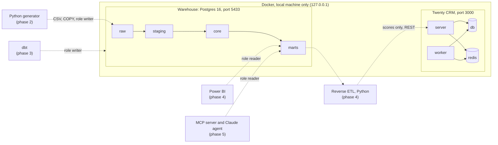

# StyleSphere CDP

A composable customer data platform (CDP) for a fictional fashion retailer.
Scope: B2C only (web store and physical shops). All data is synthetic.

## Goal

Build the core CDP notions end to end with open source tools, then mirror the same data model in a Salesforce Developer Edition org (Data 360, Agentforce).

## Stack

| Layer | Tool |
|---|---|
| CRM | Twenty (self-hosted, Docker) |
| Warehouse | PostgreSQL |
| Transformation | dbt OSS |
| Identity resolution | SQL (deterministic rules, pg_trgm, levenshtein) |
| Reverse ETL | Python scripts calling the Twenty REST API |
| BI | Power BI Desktop |
| AI agent | Claude, connected through MCP |
| CI | GitHub Actions |

## Status

| Phase | Content | Status |
|---|---|---|
| 0 | Repository, CI, secrets hygiene | Done |
| 1 | Docker: Postgres and Twenty | In progress |
| 2 | Synthetic data into `raw` | Not started |
| 3 | dbt models, identity, marts, tests | Not started |
| 4 | Reverse ETL and Power BI | Not started |
| 5 | Salesforce org and AI agent | Not started |

## Architecture

Solid lines exist today (phase 1). Dashed lines are planned in later phases.

Two Postgres roles on the warehouse: the writer owns the four schemas and is used by the generator and dbt. The reader can only select from `marts` and is used by Power BI and the agent.

## Repository layout

- `infra/warehouse/` Postgres warehouse (Docker Compose and init script)
- `infra/twenty/` Twenty CRM (override file and fetch script, the official Compose file is downloaded, not committed)
- `api/twenty/` Bruno collection for the Twenty REST API
- `ingestion/` synthetic data generator
- `dbt/` dbt project
- `reverse_etl/` scripts that push aggregates to the CRM
- `bi/` Power BI project
- `agents/` AI agent code
- `docs/decisions/` architecture decision records
- `docs/linkedin/` posting plan

## Rules

- No real personal data. Synthetic data only.
- No secret in Git. Copy `.env.example` to `.env` and fill it locally.
- The CRM receives aggregates and scores only, never raw click history.

## License

MIT
